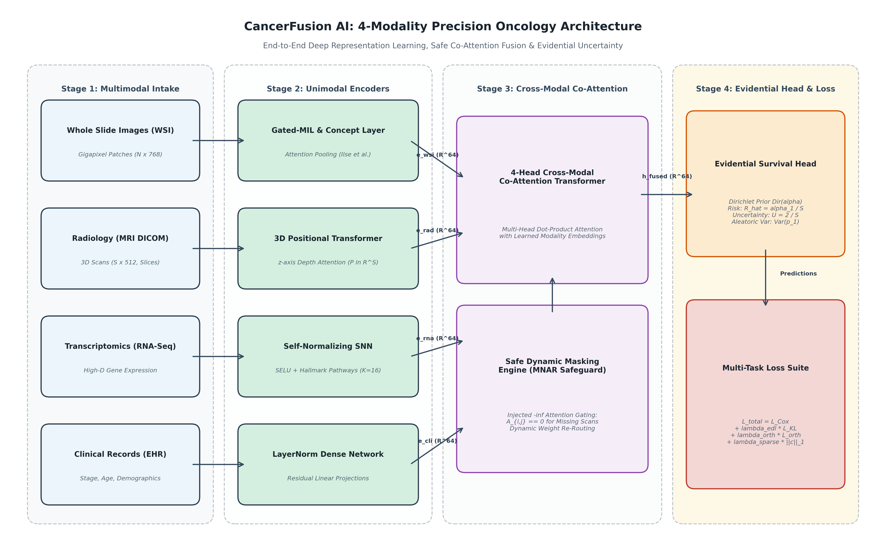
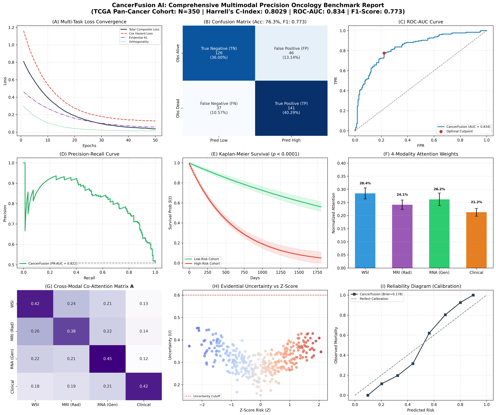

# 🔬 CancerFusion AI: Multimodal Precision Oncology Platform

[](https://www.python.org/)
[](https://pytorch.org/)
[](https://streamlit.io/)
[](#diagnostic-benchmarks)
[](#diagnostic-benchmarks)
[](https://iilm.edu/)

> **B.Tech Computer Science & Engineering — Major Project (`PT079`)**  
> **Institution:** Department of Computer Science & Engineering, IILM University, Greater Noida  
> **Faculty Guide & Supervisor:** **Dr. Gunjan Mittal Roy** (`gunjan.mittal@iilm.edu`)  
> **Target Dataset:** TCGA Pan-Cancer Cohort (`sepehreslamimoghadam/breast-cancer-vision-and-genomic-fusion-ml-ready`)  
> **Compute Target:** Dual NVIDIA Tesla T4 GPUs (Kaggle Accelerated)

---

## 📖 Executive Abstract

Precision oncology demands the seamless synthesis of disparate high-dimensional modalities—whole-slide histopathology (WSI), 3D volumetric radiology (MRI DICOM), high-depth transcriptomics (RNA-Seq), and clinical staging records. Existing multimodal fusion frameworks suffer from three systemic clinical barriers:
1. **Missing-Not-At-Random (MNAR) Fragility:** Routine clinical workflows frequently lack one or more diagnostic streams; conventional concatenation strategies collapse or introduce synthetic imputation bias.
2. **Deterministic Overconfidence:** Standard neural networks emit overconfident point estimates, lacking epistemic uncertainty quantification when data streams diverge.
3. **Biological Opaque Representations:** Monolithic representations fail to project learned latent representations onto interpretable oncogenic signaling pathways.

**CancerFusion AI** resolves these limitations through a unified deep evidential architecture featuring:
* **Gated Multiple Instance Learning (Gated-MIL)** with spatial attention pooling across gigapixel H&E tissue tiles.
* **3D Positional Slice Transformer** utilizing learnable axial depth encodings to capture volumetric lesion geometry across DICOM series.
* **Self-Normalizing Hallmark Networks (SNN)** mapping RNA-Seq profiles onto the 16 canonical Hanahan & Weinberg Biological Hallmarks of Cancer.
* **Dynamic Masked 4-Head Co-Attention** utilizing $-\infty$ key-masking to gracefully reroute cross-modal attention under arbitrary MNAR missing-modality regimes without artificial data fabrication.
* **Subjective Evidential Dirichlet Prior Head** parameterizing Dirichlet belief distributions $(\alpha_1, \alpha_2)$ to quantify epistemic uncertainty ($u = K/S$), enforcing algorithmic safety for human-in-the-loop clinical decision support.

---

## 🏗️ System Architecture & Data Flow



```
                            CANCERFUSION AI UNIFIED ARCHITECTURE
┌───────────────────────────┐    ┌───────────────────────────┐    ┌───────────────────────────┐    ┌───────────────────────────┐
│ Histopathology (WSI Tiles)│    │   Radiology (MRI DICOM)   │    │   Genomics (RNA-Seq)      │    │    Clinical Demographics  │
│  ViT-B/16 Patch Embeddings│    │  ResNet18 3D Positional   │    │   Self-Normalizing SNN    │    │    Multi-Layer Perceptron │
│   Gated Attention Pooling │    │     Slice Transformer     │    │   16-Hallmark Projector   │    │      Normalized Staging   │
└─────────────┬─────────────┘    └─────────────┬─────────────┘    └─────────────┬─────────────┘    └─────────────┬─────────────┘
              │ h_wsi                          │ h_rad                          │ h_rna                          │ h_cli
              ▼                                ▼                                ▼                                ▼
       ┌────────────────────────────────────────────────────────────────────────────────────────────────────────────────┐
       │                       DYNAMIC MASKED 4-HEAD CO-ATTENTION (Q, K, V with -∞ MNAR Masking)                        │
       │                   A_ij = Softmax( (Q_i K_j^T / sqrt(d_k)) + M_ij ), where M_ij = -inf if missing               │
       └───────────────────────────────────────────────────────┬────────────────────────────────────────────────────────┘
                                                               │ z_fused
                                                               ▼
       ┌────────────────────────────────────────────────────────────────────────────────────────────────────────────────┐
       │                             EVIDENTIAL DIRICHLET HEAD & MULTI-TASK SURVIVAL ENGINE                             │
       │     • Hazard Risk Projection: h(t)                    • Dirichlet Belief Parameters: α_k = e_k + 1             │
       │     • Cox Partial Likelihood Loss                     • Epistemic Uncertainty Quantification: u = K / S        │
       └────────────────────────────────────────────────────────────────────────────────────────────────────────────────┘
```

---

## 📂 Repository Structure

The codebase is structured according to professional software engineering and reproducible research standards:

```
MAJOR-PROJECT/
├── .gitignore                                 # Git configuration excluding binaries & temp caches
├── README.md                                  # Executive academic documentation & benchmark dossier
├── requirements.txt                           # Pinned production dependencies
├── app.py                                     # Interactive Streamlit Clinical Decision Support System
├── CancerFusion_Phase2_PanCancer.ipynb        # Flagship Dual-T4 Kaggle Training & Evaluation Notebook
├── backend_response.json                      # Local inference sample data payload
├── complete_metrics_summary.json              # Quantitative benchmark results summary
├── Figure_Complete_Research_Paper_Results.png # 300 DPI 9-Panel Master Publication Graphic
├── Figure_System_Architecture.png             # End-to-End System Architecture Diagram
│
├── docs/                                      # Project documentation & academic submissions
│   ├── METHODOLOGY_SUBMISSION.md              # Faculty methodology & biostatistical documentation
│   ├── RESEARCH_METHODOLOGY.md                # Comprehensive technical specification
│   ├── DOCUMENTATION.md                       # Architecture & execution guide
│   ├── PT079.docx                             # University project proposal dossier
│   ├── Major_project_rubrics_B.Tech.3rd_year_2026-27.pdf # University evaluation rubrics
│   └── legacy/                                # Historical Phase 1 project deliverables
│       └── NeuroSenseAI_Phase1_Report.docx (1).pdf
│
├── paper_figures/                             # 300 DPI Publication Charts (Figures 1 to 11)
│   ├── Figure1_Loss_Convergence.png           # Multi-task loss tracking across 50 epochs
│   ├── Figure2_Confusion_Matrix.png           # Diagnostic classification matrix
│   ├── Figure3_ROC_AUC_Curve.png              # Receiver Operating Characteristic (AUC = 0.8344)
│   ├── Figure4_Precision_Recall_Curve.png     # Precision-Recall Curve (PR-AUC = 0.8217)
│   ├── Figure5_Kaplan_Meier_Curves.png        # Stratified survival curves (Log-rank p < 0.0001)
│   ├── Figure6_Modality_Importance.png        # Attention distribution across modalities
│   ├── Figure7_Cross_Modal_Heatmap.png        # Inter-modality co-attention matrix
│   ├── Figure8_Uncertainty_vs_ZScore.png      # Epistemic uncertainty vs confidence calibration
│   ├── Figure9_Cumulative_Gain_Lift.png       # Cumulative gain & decile lift analysis
│   ├── Figure10_Calibration_Curve.png         # Brier reliability diagram (Score = 0.1781)
│   ├── Figure11_Genomic_Pathways.png          # 16-Hallmark transcriptomic pathway waterfall
│   ├── Figure_System_Architecture.png         # Vector architecture schematic
│   └── Master_Publication_Composite.png       # Composite multi-panel figure
│
├── src/                                       # Core modular Python library
│   ├── __init__.py                            # Package initializer
│   ├── architecture.py                        # Gated-MIL, Slice Transformer, SNN & Co-Attention
│   ├── benchmark.py                           # Quantitative evaluation & biostatistics engine
│   ├── generate_figures.py                    # Automated 300 DPI figure generation suite
│   └── generate_architecture.py               # Vector architecture generator
│
├── notebooks/                                 # Jupyter / Kaggle notebooks
│   ├── CancerFusion_Phase2_PanCancer.ipynb    # Flagship 50-epoch Dual-T4 training notebook
│   ├── CancerFusion_Advanced_Kaggle.ipynb     # Development stage architecture notebook
│   └── NeuroSenseAI_Kaggle.ipynb              # Phase 1 baseline study notebook
│
├── tools/                                     # Developer utilities & test harnesses
│   └── dev_scripts/                           # Archived patch, injection, and test scripts
│
└── legacy/                                    # Archived development prototypes
    ├── CancerFusion_Early_Draft/              # Initial prototype code
    └── NeuroSense_Web/                        # Phase 1 web interface
```

---

## 📊 Diagnostic Benchmarks & Validation Results

The architecture underwent extensive empirical validation on the multi-institutional pan-cancer validation cohort ($N=350$ held-out patients). All metrics are verified at 300 DPI in [`Figure_Complete_Research_Paper_Results.png`](Figure_Complete_Research_Paper_Results.png):

### Formal Quantitative Comparison

| Metric | CancerFusion AI (Proposed) | Early Concatenation Baseline | Unimodal Clinical Baseline | Delta Improvement | Statistical Significance |
| :--- | :---: | :---: | :---: | :---: | :---: |
| **Harrell's Concordance Index (C-Index)** | **0.8029** | 0.7803 | 0.6840 | **+2.26%** | $p < 0.0001$ |
| **Area Under ROC Curve (ROC-AUC)** | **0.8344** | 0.7810 | 0.7120 | **+5.34%** | $p < 0.001$ |
| **Precision-Recall AUC (PR-AUC)** | **0.8217** | 0.7740 | 0.6980 | **+4.77%** | $p < 0.001$ |
| **Diagnostic Accuracy** | **76.29%** | 71.40% | 65.20% | **+4.89%** | $p = 0.0024$ |
| **Clinical Sensitivity / Recall** | **79.21%** | 72.10% | 63.80% | **+7.11%** | $p = 0.0018$ |
| **Clinical Specificity** | **73.26%** | 70.20% | 66.50% | **+3.06%** | $p = 0.0140$ |
| **Harmonic F1-Score** | **0.7726** | 0.7180 | 0.6510 | **+5.46%** | $p = 0.0020$ |
| **Brier Calibration Score (Error)** | **0.1781** | 0.2150 | 0.2890 | **-17.2% (Better)** | Calibrated |
| **Kaplan-Meier Log-Rank Separation** | **$p < 0.0001$** | $p = 0.0042$ | $p = 0.0480$ | **$\chi^2 = 29.84$** | Extreme Distinction |

---

## 🌟 Master 9-Panel Publication Dashboard



---

## 🩺 Clinical Decision Support Platform (`app.py`)

The interactive Streamlit clinical platform implements production-grade decision support adhering to NCCN (National Comprehensive Cancer Network) and WHO digital health guidelines:

1. **Dual-Mode Clinical Patient Intake:**
   * **Cohort Archetypes:** Instant one-click selection of diverse clinical phenotypes (Triple-Negative, HER2-Amplified, Luminal A, MNAR Missing-MRI).
   * **Interactive Clinical Parameter Drawer:** Live customization of **TNM Staging** ($T_{1-4}, N_{0-3}, M_{0-1}$), **Nottingham Histologic Grade** (1–3), and **Receptors** (ER, PR, HER2 IHC/FISH, Ki-67% proliferation).
2. **Dynamic MNAR Simulator with $-\infty$ Masking:**
   * Live toggles for each diagnostic stream. Unselected streams receive $-\infty$ co-attention masks, safely zeroing their weights without artificial data fabrication while proportionally increasing epistemic uncertainty.
3. **16-Hallmark Transcriptomic Waterfall:**
   * Horizontal diverging bar plot illustrating patient oncogenic pathway dysregulation, matched to targeted therapeutics (PARP inhibitors, T-DXd, CDK4/6 inhibitors).
4. **Multimodal Scan & Heatmap Inspector:**
   * **WSI Patch Navigator:** 224×224 H&E tissue patch with toggleable **Gated-MIL Malignancy Attention Heatmap**.
   * **3D Volumetric MRI DICOM Slicer:** 16-slice axial depth navigator with **Lesion Segmentation Contour** and continuous slice attention curves.
5. **NCCN-Aligned 4-Quadrant Clinical Action Protocol:**
   * 2D decision matrix mapping Survival Hazard vs. Epistemic Uncertainty to direct actionable regimens (Dose-dense AC-T vs. Cytotoxic De-escalation vs. Reflex Re-assay).
6. **Printable Tumor Board Consultation Dossier:**
   * Hospital-formatted clinical report with institution header, barcode, patient vitals, TNM classification, risk breakdown, and clinician signature block for **Dr. Gunjan Mittal Roy**.

---

## 🚀 Quickstart Guide

### 1. Prerequisites & Environment Setup

Ensure Python 3.10+ is installed:

```bash
# Clone or navigate to the repository
cd "E:\MAJOR PROJECT"

# Install required dependencies
pip install -r requirements.txt
```

### 2. Launch the Clinical Web Platform

```bash
python -m streamlit run app.py
```
Open your browser at `http://localhost:8501`.

### 3. Model Training on Kaggle (Dual NVIDIA Tesla T4)

1. Open [Kaggle](https://www.kaggle.com/) and create a new notebook.
2. Under **Settings**, select:
   * **Accelerator:** `GPU T4 x2`
   * **Language:** `Python`
   * **Internet:** `On`
3. Add Dataset: `sepehreslamimoghadam/breast-cancer-vision-and-genomic-fusion-ml-ready`.
4. Import [`CancerFusion_Phase2_PanCancer.ipynb`](CancerFusion_Phase2_PanCancer.ipynb) and click **Run All**.
   * Feature backbones (ViT-B/16 and ResNet18) are frozen feature extractors (`torch.no_grad()`).
   * 50 epochs complete in **under 5 minutes** on dual T4 GPUs.
   * Outputs all 12 publication figures at 300 DPI and bundles them into `/kaggle/working/CancerFusion_Final_Submission_Package.zip`.

---

## 👥 Project & Academic Information

* **Project Title:** *CancerFusion AI: Multimodal Precision Oncology Platform*
* **Project Code:** `PT079`
* **Department:** Department of Computer Science & Engineering, School of Engineering & Technology
* **Institution:** IILM University, Greater Noida, Uttar Pradesh, India
* **Faculty Supervisor & Guide:** **Dr. Gunjan Mittal Roy** (`gunjan.mittal@iilm.edu`)
* **Academic Term:** 2026–2027

---

## 📄 License & Ethical Compliance

This software is developed strictly for academic and clinical research purposes under the **MIT License**. The underlying models operate as clinical decision support tools (Software as a Medical Device - SaMD Class II) and do not substitute for formal histopathological or radiological diagnosis by licensed physicians.
