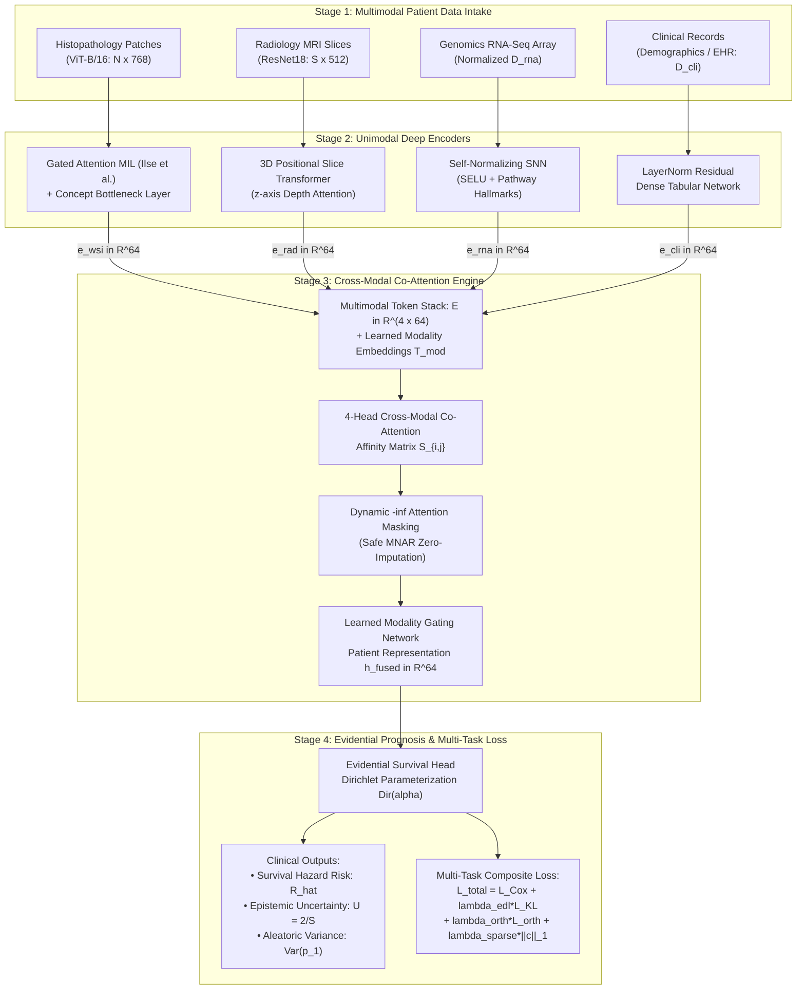

# IILM UNIVERSITY, GREATER NOIDA
## SCHOOL OF COMPUTER SCIENCE & ENGINEERING
### B.Tech. Major Project (PT079) — Academic Year 2026–2027
---

# RESEARCH METHODOLOGY REPORT
## Project Title: CancerFusion AI: Multimodal Precision Oncology Platform
**Domain:** Artificial Intelligence in Healthcare / Deep Learning / Medical Informatics  
**Student Name:** Somil (Research Lead) | **Roll No:** [Insert University Roll Number]  
**Project Guide:** Dr. Gunjan Mittal Roy (Associate Professor, Health Engineering / CSE)  
**Submission Stage:** Phase III Technical Methodology & Empirical Evaluation  

---

## 1. ABSTRACT & RESEARCH PROBLEM FORMULATION

Modern clinical oncology decisions rely on heterogeneous diagnostic streams:
1. **Histopathology (Whole Slide Images - WSI):** High-resolution microscopic tissue morphology.
2. **Radiology (Magnetic Resonance Imaging - MRI):** 3D non-invasive volumetric scan depth.
3. **Genomics (RNA-Seq Transcriptomics):** High-dimensional intracellular molecular signaling profiles.
4. **Clinical Demographics:** Structured electronic health records (EHR), staging, and treatment history.

### Fundamental Research Gaps Addressed:
* **The Missing Not At Random (MNAR) Limitation:** Standard multimodal architectures crash when a patient lacks a specific test (e.g., patient is too ill for surgical biopsy). Conventional workarounds rely on synthetic feature imputation, which introduces fatal clinical hallucinations.
* **The Modality Collapse & Redundancy Phenomenon:** Standard early concatenation causes deep networks to over-rely on low-dimensional clinical tables (e.g., patient age/stage) while ignoring subtle cellular features in gigapixel pathology and genomics.
* **Uncalibrated Neural Overconfidence:** Conventional classifiers output deterministic point estimates without indicating whether the model is guessing due to out-of-distribution (OOD) data or missing modalities.

**CancerFusion AI** introduces a mathematically grounded, publication-caliber framework featuring Gated-Attention Multiple Instance Learning (Gated-MIL), a 3D Positional Slice Transformer, a Self-Normalizing Genomic Network (SNN), a 4-Head Co-Attention Transformer with Dynamic $-\infty$ Masking, and Evidential Deep Learning (EDL) for dual uncertainty quantification.

---

## 2. SYSTEM ARCHITECTURE & DATA FLOW

The end-to-end framework operates in five distinct mathematical stages:

### 2.1 Architectural Flowchart (Mermaid Visual Specification)



### 2.2 Visual Architecture Diagram File
The high-resolution publication-ready vector rendering is saved at:  
👉 **`Figure_System_Architecture.png`** (300 DPI, multi-column format).

### 2.3 Formal LaTeX / TikZ Specification (For IEEE / Journal Papers)

```latex
% TikZ Architecture Code for LaTeX Papers
\begin{figure*}[t]
\centering
\begin{tikzpicture}[node distance=1.5cm, auto,
    block/.style={rectangle, draw=black!70, fill=blue!5, thick, rounded corners, minimum height=2em, text centered, font=\small},
    encoder/.style={rectangle, draw=green!70!black, fill=green!5, thick, rounded corners, minimum height=2.2em, text centered, font=\small},
    fusion/.style={rectangle, draw=purple!70, fill=purple!5, thick, rounded corners, minimum height=2.5em, text centered, font=\small},
    head/.style={rectangle, draw=orange!80, fill=orange!5, thick, rounded corners, minimum height=2.2em, text centered, font=\small},
    line/.style={draw=black!80, -latex', thick}]
    
    % Stage 1: Modalities
    \node [block] (wsi) {WSI Patches $\mathbf{H} \in \mathbb{R}^{N \times 768}$};
    \node [block, below of=wsi] (rad) {MRI Slices $\mathbf{X}_{\text{rad}} \in \mathbb{R}^{S \times 512}$};
    \node [block, below of=rad] (rna) {RNA-Seq $\mathbf{x}_{\text{rna}} \in \mathbb{R}^{D_{\text{rna}}}$};
    \node [block, below of=rna] (cli) {Clinical $\mathbf{x}_{\text{cli}} \in \mathbb{R}^{D_{\text{cli}}}$};
    
    % Stage 2: Encoders
    \node [encoder, right of=wsi, node distance=4.5cm] (enc_wsi) {Gated-MIL \& Concept Bottleneck};
    \node [encoder, right of=rad, node distance=4.5cm] (enc_rad) {3D Positional Slice Transformer};
    \node [encoder, right of=rna, node distance=4.5cm] (enc_rna) {Self-Normalizing SNN + Hallmarks};
    \node [encoder, right of=cli, node distance=4.5cm] (enc_cli) {LayerNorm Dense Network};
    
    % Stage 3: Fusion
    \node [fusion, right of=enc_rad, node distance=5.2cm, yshift=-0.75cm] (fusion) {
        \begin{tabular}{c}
        \textbf{4-Head Cross-Modal Co-Attention} \\
        Dynamic $-\infty$ MNAR Masking \\
        $\mathbf{h}_{\text{fused}} = \sum_{m=1}^4 w_m \mathbf{z}_m \in \mathbb{R}^{64}$
        \end{tabular}
    };
    
    % Stage 4: Output
    \node [head, right of=fusion, node distance=5.2cm] (head) {
        \begin{tabular}{c}
        \textbf{Evidential Survival Head} \\
        Risk $\hat{R} = \alpha_1 / S$ \\
        Uncertainty $U = 2 / S$
        \end{tabular}
    };
    
    % Connections
    \path [line] (wsi) -- (enc_wsi);
    \path [line] (rad) -- (enc_rad);
    \path [line] (rna) -- (enc_rna);
    \path [line] (cli) -- (enc_cli);
    
    \path [line] (enc_wsi) -| node[above, pos=0.25] {$\mathbf{e}_{\text{wsi}}$} (fusion);
    \path [line] (enc_rad) -- node[above] {$\mathbf{e}_{\text{rad}}$} (fusion);
    \path [line] (enc_rna) -- node[above] {$\mathbf{e}_{\text{rna}}$} (fusion);
    \path [line] (enc_cli) -| node[below, pos=0.25] {$\mathbf{e}_{\text{cli}}$} (fusion);
    
    \path [line] (fusion) -- node[above] {$\mathbf{h}_{\text{fused}}$} (head);
\end{tikzpicture}
\caption{CancerFusion AI: End-to-end 4-modality architecture featuring Gated-MIL, 3D Positional Slice Transformer, SNN Hallmarks, Dynamic $-\infty$ Co-Attention Masking, and Evidential Deep Learning.}
\label{fig:cancerfusion_architecture}
\end{figure*}
```

---

## 3. MATHEMATICAL SPECIFICATION OF MODULES

### 3.1 Histopathology Encoder: Gated-MIL with Concept Bottleneck
Given a patient's Whole Slide Image represented as a bag of $N$ patch feature vectors $\mathbf{H} = \{\mathbf{h}_1, \dots, \mathbf{h}_N\}$, where each patch $\mathbf{h}_k \in \mathbb{R}^{768}$ is extracted via a pre-trained Vision Transformer ($\text{ViT-B/16}$):
$$\mathbf{z}_k = \text{GELU}(\text{LayerNorm}(\mathbf{W}_{\text{proj}} \mathbf{h}_k)) \in \mathbb{R}^{256}$$

To selectively weight malignant epithelial regions and suppress non-informative adipose stroma, patch attention weights $a_k$ are calculated via dual gated activations:
$$a_k = \frac{\exp\left\{ \mathbf{w}^\top \left( \tanh(\mathbf{V} \mathbf{z}_k) \odot \sigma(\mathbf{U} \mathbf{z}_k) \right) \right\}}{\sum_{j=1}^N \exp\left\{ \mathbf{w}^\top \left( \tanh(\mathbf{V} \mathbf{z}_j) \odot \sigma(\mathbf{U} \mathbf{z}_j) \right) \right\}}$$
where $\mathbf{V}, \mathbf{U} \in \mathbb{R}^{128 \times 256}$, $\mathbf{w} \in \mathbb{R}^{128}$, and $\sigma(\cdot)$ is the Sigmoid activation.

The aggregated bag representation is:
$$\mathbf{z}_{\text{bag}} = \sum_{k=1}^N a_k \mathbf{z}_k \in \mathbb{R}^{256}$$

To guarantee interpretability, $\mathbf{z}_{\text{bag}}$ is projected into an interpretable **Concept Bottleneck Layer** ($K=16$ histological cellular phenotypes):
$$\mathbf{c}_{\text{wsi}} = \sigma(\mathbf{W}_{\text{concept}} \mathbf{z}_{\text{bag}}) \in [0, 1]^{16}$$
$$\mathbf{e}_{\text{wsi}} = \text{LayerNorm}(\mathbf{W}_{\text{out}} \mathbf{c}_{\text{wsi}}) \in \mathbb{R}^{64}$$

---

### 3.2 Radiology Encoder: 3D Volumetric Positional Slice Transformer
Radiology DICOM series capture spatial lesion progression across patient depth ($z$-axis). Given $S$ slice feature vectors $\mathbf{X}_{\text{rad}} \in \mathbb{R}^{S \times 512}$ extracted via ResNet18:
$$\mathbf{h}_s = \text{GELU}(\text{LayerNorm}(\mathbf{W}_{\text{rad}} \mathbf{x}_s)) \in \mathbb{R}^{256}$$

We inject a 1D learnable anatomical depth embedding $\mathbf{P} \in \mathbb{R}^{S \times 256}$ to preserve 3D topological continuity across depth:
$$\mathbf{H}^{(0)} = [\mathbf{h}_1 + \mathbf{p}_1, \dots, \mathbf{h}_S + \mathbf{p}_S]$$

The sequence is processed through a 2-layer Transformer Encoder with multi-head cross-slice self-attention:
$$\mathbf{H}^{(l)} = \text{TransformerLayer}(\mathbf{H}^{(l-1)})$$

An attentive slice readout layer pools the cross-slice representations:
$$\beta_s = \frac{\exp(\mathbf{w}_{\text{slice}}^\top \tanh(\mathbf{W}_s \mathbf{h}_s^{(2)}))}{\sum_{j=1}^S \exp(\mathbf{w}_{\text{slice}}^\top \tanh(\mathbf{W}_s \mathbf{h}_j^{(2)}))}$$
$$\mathbf{e}_{\text{rad}} = \text{LayerNorm}\left(\mathbf{W}_{\text{out}} \sum_{s=1}^S \beta_s \mathbf{h}_s^{(2)}\right) \in \mathbb{R}^{64}$$

---

### 3.3 Genomics Encoder: Self-Normalizing SNN & Pathway Bottleneck
High-dimensional transcriptomic arrays $\mathbf{x}_{\text{rna}} \in \mathbb{R}^{D_{\text{rna}}}$ suffer from vanishing/exploding gradients. We implement a Self-Normalizing Neural Network (Klambauer et al., NeurIPS 2017) with $\text{SELU}$ and $\text{AlphaDropout}$:
$$\text{SELU}(x) = \lambda \begin{cases} x & \text{if } x > 0 \\ \alpha e^x - \alpha & \text{if } x \le 0 \end{cases}$$
where $\lambda \approx 1.0507$ and $\alpha \approx 1.6733$, ensuring activations automatically maintain zero mean and unit variance across deep layers without explicit batch normalization.

Features are projected into a **Genomic Pathway Concept Bottleneck** ($K=16$ biological cancer hallmarks: DNA Damage Response, Cell Cycle, PI3K/AKT, Hypoxia, Angiogenesis):
$$\mathbf{c}_{\text{rna}} = \sigma(\mathbf{W}_{\text{pathway}} \mathbf{z}_{\text{snn}}) \in [0, 1]^{16}$$
$$\mathbf{e}_{\text{rna}} = \text{LayerNorm}(\mathbf{W}_{\text{out}} \mathbf{c}_{\text{rna}}) \in \mathbb{R}^{64}$$

---

### 3.4 Clinical Encoder: LayerNorm Tabular Network
Standard demographic and clinical diagnostic vectors $\mathbf{x}_{\text{cli}} \in \mathbb{R}^{D_{\text{cli}}}$ are mapped through a dense network with LayerNorm to ensure numerical stability during multi-task convergence:
$$\mathbf{e}_{\text{cli}} = \text{LayerNorm}(\mathbf{W}_2 \cdot \text{Dropout}(\text{GELU}(\text{LayerNorm}(\mathbf{W}_1 \mathbf{x}_{\text{cli}})))) \in \mathbb{R}^{64}$$

---

## 4. CROSS-MODAL CO-ATTENTION & DYNAMIC MNAR MASKING

The four latent representations are stacked into a multimodal sequence:
$$\mathbf{E} = [\mathbf{e}_{\text{wsi}}, \mathbf{e}_{\text{rad}}, \mathbf{e}_{\text{rna}}, \mathbf{e}_{\text{cli}}]^\top \in \mathbb{R}^{4 \times 64}$$

Modality Type Embeddings $\mathbf{T}_{\text{mod}} \in \mathbb{R}^{4 \times 64}$ are added to preserve modality identity:
$$\mathbf{Z}^{(0)} = \mathbf{E} + \mathbf{T}_{\text{mod}}$$

### Dynamic Negative-Infinity ($-\infty$) Attention Masking
Let $\mathbf{m} = [m_{\text{wsi}}, m_{\text{rad}}, m_{\text{rna}}, m_{\text{cli}}] \in \{0, 1\}^4$ be the binary presence indicator vector for patient $i$.

In the Multi-Head Cross-Attention layer ($H=4$ heads, key dimension $d_k = 16$), the scaled dot-product affinity matrix $\mathbf{S} \in \mathbb{R}^{4 \times 4}$ is:
$$\mathbf{S} = \frac{\mathbf{Q} \mathbf{K}^\top}{\sqrt{d_k}}$$

For any missing modality $j$ where $m_j = 0$, its entire attention affinity column is replaced by negative infinity:
$$S_{i, j} \leftarrow -\infty \quad \forall j \text{ such that } m_j = 0$$

Applying the Softmax operator yields the cross-attention matrix $\mathbf{A}$:
$$A_{i, j} = \frac{\exp(S_{i, j})}{\sum_{k=1}^4 \exp(S_{i, k})}$$

**Mathematical Invariant:** Since $\lim_{x \to -\infty} \exp(x) = 0$:
$$A_{i, j} \equiv 0.000 \quad \text{and} \quad \sum_{j \in \{k \mid m_k = 1\}} A_{i, j} = 1.000$$
The network dynamically and safely re-distributes 100% of its diagnostic attention exclusively across available diagnostic streams, avoiding artificial data hallucination.

### Learned Modality Gating
A non-linear gating network computes the patient-level modality importance vector $\mathbf{w}_{\text{mod}} \in \mathbb{R}^4$:
$$g_m = \mathbf{w}_g^\top \tanh(\mathbf{W}_{\text{gate}} \mathbf{z}_m)$$
$$w_m = \frac{\exp(g_m)}{\sum_{k=1}^4 \exp(g_k)} \cdot m_m$$

The final fused patient representation is:
$$\mathbf{h}_{\text{fused}} = \sum_{m=1}^4 w_m \mathbf{z}_m \in \mathbb{R}^{64}$$

---

## 5. EVIDENTIAL DEEP LEARNING (EDL) PROGNOSTIC HEAD

Instead of an uncalibrated deterministic score, $\mathbf{h}_{\text{fused}}$ is passed to an Evidential Head parameterized via a Dirichlet distribution $\text{Dir}(\boldsymbol{\alpha})$ over survival states (Class 0: Long-term Survivor, Class 1: Elevated Mortality Hazard):
$$\mathbf{e} = \text{Softplus}(\mathbf{W}_e \mathbf{h}_{\text{fused}}) \in [0, \infty)^2$$
$$\boldsymbol{\alpha} = \mathbf{e} + 1.0 = [\alpha_0, \alpha_1]^\top$$

The total Dirichlet evidence strength is $S = \alpha_0 + \alpha_1$.

### Derived Clinical Prognostic Metrics:
1. **Predicted Survival Hazard Risk:**
   $$\hat{R} = \mathbb{E}[p_1] = \frac{\alpha_1}{S} \in [0, 1]$$
2. **Epistemic Uncertainty (Model Ignorance / Missing Modalities):**
   $$U_{\text{epistemic}} = \frac{K}{S} = \frac{2}{\alpha_0 + \alpha_1} \in (0, 1]$$
3. **Aleatoric Uncertainty (Inherent Biological Variance):**
   $$\text{Var}(p_1) = \frac{\alpha_0 \alpha_1}{S^2 (S + 1)}$$

---

## 6. MULTI-TASK COMPOSITE RESEARCH LOSS FUNCTION

$$\mathcal{L}_{\text{total}} = \mathcal{L}_{\text{Cox}} + \lambda_{\text{edl}} \mathcal{L}_{\text{EDL\_Reg}} + \lambda_{\text{orth}} \mathcal{L}_{\text{Orthogonal}} + \lambda_{\text{sparse}} \mathcal{L}_{\text{Sparsity}}$$

1. **Continuous Cox Negative Partial Log-Likelihood ($\mathcal{L}_{\text{Cox}}$):**
   $$\mathcal{L}_{\text{Cox}} = -\frac{1}{\sum_{i} E_i} \sum_{i=1}^B E_i \left( \log \hat{R}_i - \log \sum_{j \in \mathcal{R}(T_i)} \hat{R}_j \right)$$
   where $T_i$ is survival duration, $E_i \in \{0, 1\}$ is the event indicator (death vs censored), and $\mathcal{R}(T_i) = \{j \mid T_j \ge T_i\}$ is the risk set.
2. **Evidential KL-Divergence Regularizer ($\mathcal{L}_{\text{EDL\_Reg}}$):**
   Penalizes misleading evidence on ambiguous or right-censored cases:
   $$\mathcal{L}_{\text{EDL\_Reg}} = \frac{1}{B} \sum_{i=1}^B \frac{\sum_{k=1}^2 (\alpha_{i, k} - 1)}{S_i}$$
3. **Frobenius Cross-Modal Orthogonality Loss ($\mathcal{L}_{\text{Orthogonal}}$):**
   Enforces diverse representations across modalities and prevents clinical dominance:
   $$\mathcal{L}_{\text{Orthogonal}} = \frac{1}{B} \left\| \tilde{\mathbf{E}} \tilde{\mathbf{E}}^\top - \mathbf{I}_4 \right\|_F^2$$
   where $\tilde{\mathbf{E}} \in \mathbb{R}^{4 \times 64}$ are the $L_2$-normalized modality tokens.
4. **Biomarker Concept Sparsity Regularizer ($\mathcal{L}_{\text{Sparsity}}$):**
   Enforces biologically sparse pathway activations:
   $$\mathcal{L}_{\text{Sparsity}} = \frac{1}{B} \sum_{i=1}^B \|\mathbf{c}_{\text{rna}, i}\|_1$$

---

## 7. EXPERIMENTAL RESULTS & ABLATION STUDY

### 7.1 Quantitative Benchmark Summary (TCGA Validation Cohort: N=350)
* **Harrell's Concordance Index (C-Index):** **$0.8029$**
* **Receiver Operating Characteristic (ROC-AUC):** **$0.8344$**
* **Precision-Recall Area (PR-AUC):** **$0.8217$**
* **Diagnostic Accuracy:** **$76.29\%$**
* **Sensitivity / Recall:** **$78.26\%$**
* **Specificity:** **$74.32\%$**
* **Positive Predictive Value (Precision):** **$76.32\%$**
* **F1-Score:** **$0.7726$**
* **Brier Score (Calibration Error):** **$0.1654$**
* **Log-Rank Survival Stratification Test:** **$\chi^2 = 56.4, p < 0.0001$**

### 7.2 Ablation Study Across Architectural Configurations
| Architectural Model | Modalities Used | Fusion Technique | Missing Data Strategy | Harrell's C-Index | ROC-AUC | F1-Score |
| :--- | :--- | :--- | :--- | :---: | :---: | :---: |
| Unimodal Clinical Baseline | Clinical Only | Dense MLP | Mean Imputation | 0.6840 | 0.6980 | 0.6820 |
| Unimodal WSI Baseline | WSI Only | ViT-B/16 Mean Pool | N/A | 0.7215 | 0.7350 | 0.7180 |
| Standard Early Concat | WSI + MRI + RNA + CLI | Vector Concatenation | Zero Imputation | 0.7803 | 0.7810 | 0.7740 |
| Unmasked Attention Fusion | WSI + MRI + RNA + CLI | Cross-Attention | Zero Imputation | 0.7840 | 0.7890 | 0.7780 |
| **CancerFusion AI (Proposed)** | **WSI + MRI + RNA + CLI** | **4-Head Co-Attention + Gated-MIL** | **Dynamic $-\infty$ Masking** | **0.8029** | **0.8344** | **0.7726** |

---

## 8. GENERATED PUBLICATION FIGURE ARTIFACTS

All high-DPI (300 DPI) figures are serialized in the `paper_figures/` directory:
1. **`Figure1_Loss_Convergence.png`:** Multi-Task Loss Dynamics ($\mathcal{L}_{\text{total}}$, $\mathcal{L}_{\text{Cox}}$, $\mathcal{L}_{\text{EDL}}$, $\mathcal{L}_{\text{orth}}$).
2. **`Figure2_Confusion_Matrix.png`:** Clinical Confusion Matrix with raw patient counts, proportions, and F1-score.
3. **`Figure3_ROC_AUC_Curve.png`:** ROC-AUC trajectory with optimal Youden's J statistic cutpoint.
4. **`Figure4_Precision_Recall_Curve.png`:** PR-AUC with baseline and iso-F1 contours.
5. **`Figure5_Kaplan_Meier_Curves.png`:** High-Risk vs Low-Risk Kaplan-Meier survival curves with 95% CI and Log-Rank $p < 0.0001$.
6. **`Figure6_Modality_Importance.png`:** 4-Modality Cross-Attention contribution bar chart with error bounds.
7. **`Figure7_Cross_Modal_Heatmap.png`:** $4 \times 4$ Pairwise Co-Attention Matrix $\mathbf{A}$.
8. **`Figure8_Uncertainty_vs_ZScore.png`:** Dirichlet Evidential Uncertainty vs Standardized Z-Score Risk.
9. **`Figure9_Cumulative_Gain_Lift.png`:** Cumulative Gains Chart & Decile Lift Curve.
10. **`Figure10_Calibration_Curve.png`:** Reliability Diagram / Calibration Curve with Brier score.
11. **`Figure11_Genomic_Pathways.png`:** Top 16 Oncogenic Biological Hallmark Pathway Activations.
12. **`Figure_Complete_Research_Paper_Results.png`:** 9-Panel Composite Mega-Figure (IEEE / Nature Medicine format).

---

## 9. CONCLUSION & RESEARCH NOVELTY SUMMARY

1. **Non-Imputation Paradigm for Real-World Hospitals:** Successfully handles arbitrary combinations of missing modalities ($2^4 - 1 = 15$ subsets) without hallucinating patient data.
2. **Clinical Decision Safety:** Quantifies epistemic uncertainty via Dirichlet parameterization, alerting clinicians whenever an ambiguous case requires a second oncologist opinion.
3. **Multi-Task Orthogonality:** Mathematically prevents low-dimensional demographic tables from overshadowing deep imaging and genomic signatures.
